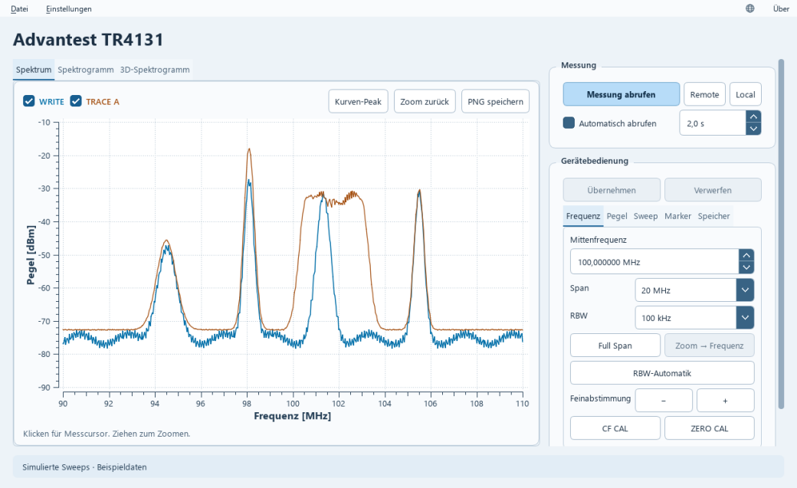
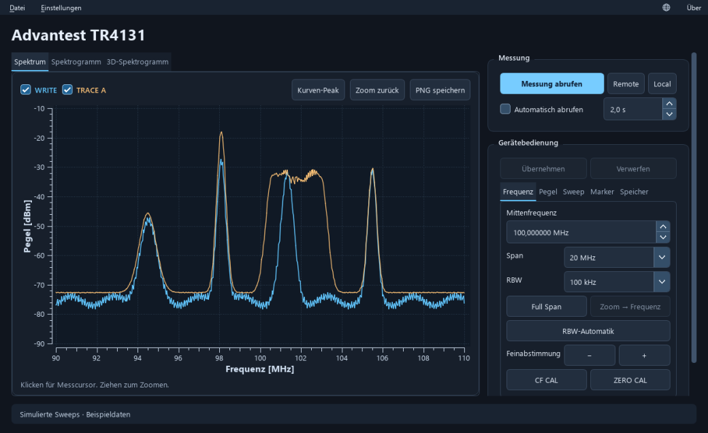
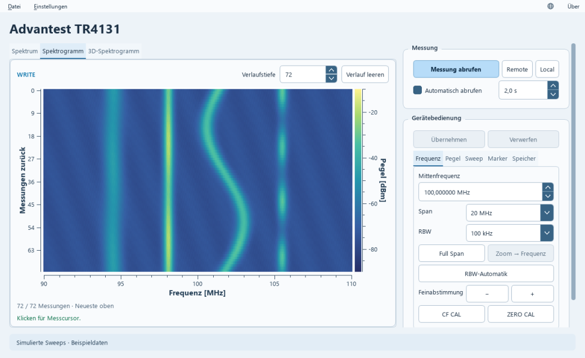
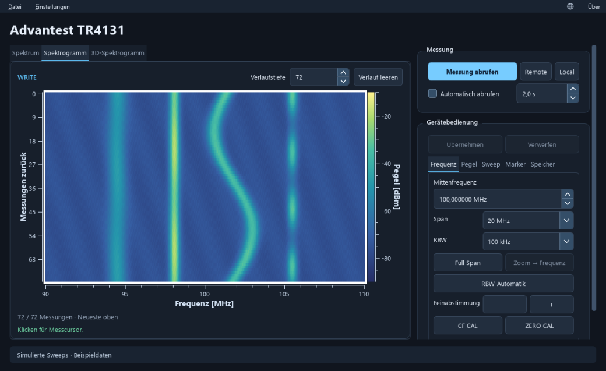
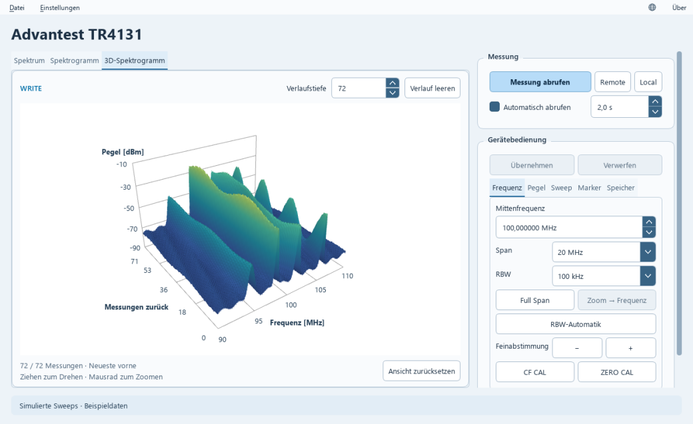
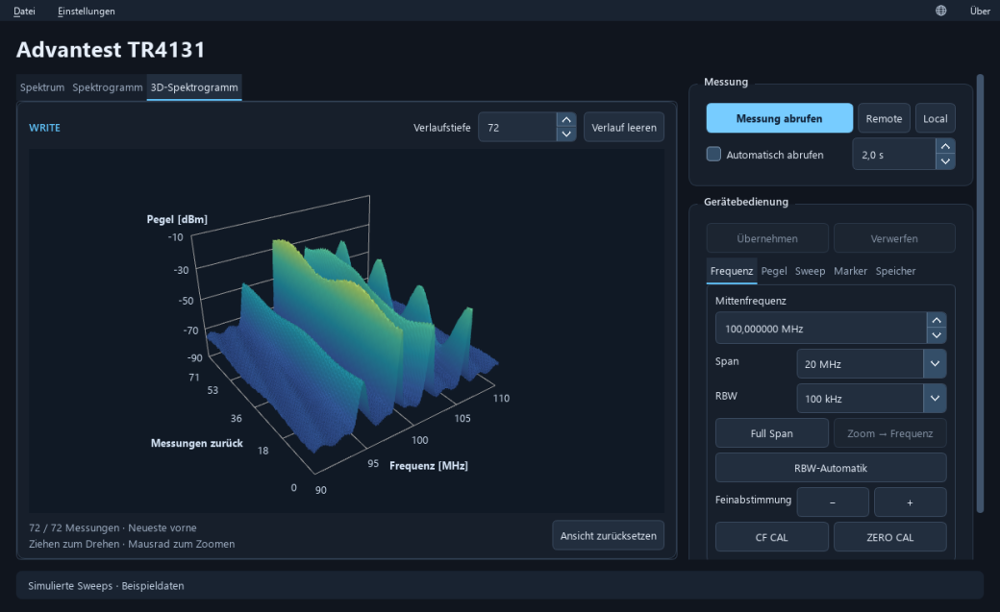

# TR4131 Viewer

Qt-6-Widgets-Anwendung für den Advantest TR4131 unter Windows x64. Das Spektrum verwendet Qwt 6.3. Der TR4131 wird über NI-488.2 oder den Elektor-USB-GPIB-Adapter angesprochen.

Der TR4131 Viewer ist eine Neuimplementierung der TR4131-Anbindung aus dem ursprünglichen Java-Projekt OsciViewer von Ralf Tralow. [OsciViewer auf SourceForge](https://sourceforge.net/projects/osziviewer/)

## Bildschirmaufnahmen

Alle Ansichten zeigen dieselben simulierten Sweeps.

### Frequenzdiagramm

| Hell | Dunkel |
| --- | --- |
| <a href="docs/screenshots/tr4131-frequenz-hell.png"></a> | <a href="docs/screenshots/tr4131-frequenz-dunkel.png"></a> |

### Spektrogramm

| Hell | Dunkel |
| --- | --- |
| <a href="docs/screenshots/tr4131-spektrogramm-hell.png"></a> | <a href="docs/screenshots/tr4131-spektrogramm-dunkel.png"></a> |

### 3D-Spektrogramm

| Hell | Dunkel |
| --- | --- |
| <a href="docs/screenshots/tr4131-3d-hell.png"></a> | <a href="docs/screenshots/tr4131-3d-dunkel.png"></a> |

## Installation unter Windows

Das [GitHub-Release](https://github.com/GitterRalf/tr4131-viewer/releases/latest) bietet zwei Windows-Installer mit Qt-, Qwt- und MinGW-Laufzeitdateien. Für den Download ist ein GitHub-Konto mit Zugriff auf das private Repository erforderlich.

| Setup | Qt-Kit | Standardordner |
| --- | --- | --- |
| x64 (64 Bit) | Qt 6.11.0 / MinGW 13.1 | Programme → TR4131 Viewer |
| x86 (32 Bit) | Qt 5.15.19 / MinGW 8.1 | 32-Bit-Programme → TR4131 Viewer (32 Bit) |

Die x86-Ausgabe läuft unter 32-Bit-Windows und kann unter x64-Windows parallel zur 64-Bit-Ausgabe installiert werden. Je nach Adapter den NI-488.2-Treiber mit Unterstützung für die Bitbreite der Anwendung oder den virtuellen COM-Port-Treiber separat installieren. Die 3D-Ansicht nutzt OpenGL.

## Starten

TR4131 Viewer über das Startmenü oder nach einem lokalen Build über `build-spectrogram\TR4131-Viewer.exe` öffnen. Standardmäßig ist GPIB-Bus **0** mit Geräteadresse **3** eingestellt. **Messung abrufen** liest die Messparameter und beide Kurvenspeicher. Die Messung läuft währenddessen im Hintergrund. **Automatisch abrufen** startet wiederholte Messungen mit einer Wartezeit von 0,5 bis 60 Sekunden (Vorgabe 2 Sekunden). Die Wartezeit beginnt nach Abschluss des jeweiligen Abrufs. Bei einem Lesefehler öffnet der nächste automatische Versuch die Verbindung neu. Bei wiederholten Fehlern verlängert sich die Wartezeit. Die Checkbox stoppt die Wiederholungen. Ungesendete Änderungen pausieren den Automatikbetrieb. Bei identischer Achsenskalierung bleibt der Diagrammzoom erhalten. Die Gerätewerte können danach in den Reitern bearbeitet werden. **Übernehmen** sendet die geänderten Werte und zeigt anschließend an, welche Einstellungen das Gerät meldet. **Verwerfen** lädt die zuletzt gelesenen Werte wieder in die Eingabefelder.

## Spektrogramm

Der Reiter **Spektrogramm** zeigt die letzten WRITE-Messungen als Wasserfall. Die neueste Messung steht oben. Die Farbe entspricht dem Pegel. Die Legende rechts verwendet die zuletzt gelesene Pegelskala des Geräts. Im Zero Span zeigt die horizontale Achse die Zeit innerhalb eines Sweeps. Ein Klick in die Messfläche schaltet den Cursor ein oder aus. Beim Bewegen der Maus zeigt er Frequenz oder Zero-Span-Zeit, Pegel und Messzeile an. Zeile 0 ist die neueste Messung.

**Verlaufstiefe** legt die maximale Anzahl der dargestellten Messungen fest (1 bis 1000, Vorgabe 120). **Einstellungen → Einstellungen speichern** speichert die Tiefe für den nächsten Start. **Verlauf leeren** oder ein Wechsel des Messrasters, der Pegel-Einheit oder der Geräteadresse beginnt eine neue Reihe. Mit **Automatisch abrufen** füllt sich der Verlauf fortlaufend. Sobald Messraster und Pegelskala für die gewählte Verbindung vorliegen, liest der automatische Abruf im Reiter **Spektrogramm** nur den WRITE-Speicher. **Messung abrufen** aktualisiert die Geräteparameter und beide Kurven, etwa nach Änderungen direkt am Gerät. **Datei → PNG speichern** exportiert die aktive Ansicht.

## 3D-Spektrogramm

Der zusätzliche Reiter **3D-Spektrogramm** zeigt Frequenz, Messverlauf und Pegel als räumliche Fläche. Höhe und Farbe entsprechen dem Pegel, die neueste Messung steht vorne. Mit gedrückter linker Maustaste drehen, mit dem Mausrad zoomen. **Ansicht zurücksetzen** stellt die Ausgangsperspektive wieder her.

Die 2D- und 3D-Ansicht verwenden denselben WRITE-Verlauf und dieselbe Tiefe. Tiefenänderungen und **Verlauf leeren** wirken auf beide Ansichten. Der automatische Abruf verwendet auch im 3D-Reiter den WRITE-Schnellabruf. **Datei → PNG speichern** exportiert die aktuelle 3D-Perspektive. Die 3D-Darstellung benötigt OpenGL.

## Gerätebedienung

| Reiter | Funktionen |
|---|---|
| Frequenz | Mittenfrequenz, Span einschließlich Zero Span, RBW, Full Span, Zoom als Frequenzvorgabe, RBW-Automatik, Feinabstimmung, CF CAL und ZERO CAL |
| Pegel | Referenzpegel, Pegeleinheit, logarithmische und lineare Skala, Quasi-Peak, Pegelschritte und Mindestdämpfung |
| Sweep | Trigger, Sweep-Zeit, Videofilter, Single-Sweep und Detektorwahl |
| Marker | Gerätemarker, Peak-Suche, Marker auf Mittenfrequenz, Signal-Track, Normierung, Noise/Hz und Pegellinie |
| Speicher | WRITE, MAX HOLD, STORE, VIEW, die drei Gerätespeicher und die Gerätegrundeinstellung |

**Remote** und **Local** schalten die Bedienung am Gerät um. Einige Funktionen, etwa der Normal-Detektor, hängen von der Geräteausstattung ab. Bei Feldstärkeeinheiten steht die schrittweise Referenzpegeländerung zur Verfügung.

**Full Span** stellt 4 GHz Span, 2 GHz Mittenfrequenz und 1 MHz RBW ein. **Zoom → Frequenz** übernimmt den horizontalen Ausschnitt aus dem gezoomten Diagramm. Es wählt den kleinsten verfügbaren Span, der den Ausschnitt vollständig abdeckt, und behält die gewählte RBW bei. Beide Schaltflächen übernehmen ausstehende Änderungen sofort am TR4131 und lesen die Gerätewerte danach zurück.

Ein Linksklick ins Diagramm aktiviert den Messcursor. Beim Bewegen der Maus zeigt er Frequenz und Pegel des nächstgelegenen Messpunkts. Bei Zero Span zeigt er Zeit und Pegel. Ein weiterer Linksklick blendet ihn aus. Mit gedrückter linker Maustaste ziehst du ein Rechteck zum Zoomen auf. **Kurven-Peak** berechnet das Maximum der empfangenen WRITE-Kurve im Viewer. **Geräte-Peak** führt die Suche am TR4131 aus und blendet den gemeldeten Marker gelb ein. **PNG speichern** speichert das Diagramm. **Datei → Daten als CSV speichern** exportiert alle Punkte der zuletzt gelesenen Messung mit Frequenz in Hz oder bei Zero Span mit Zeit in Sekunden. Die Datei enthält WRITE sowie TRACE A, wenn vorhanden. Die Werte sind durch Semikolons getrennt und verwenden das Dezimalzeichen der gewählten Sprache. Bei PNG und CSV enthält der vorgeschlagene Dateiname das lokale Datum und die Uhrzeit im Format `TR4131_JJJJ-MM-TT_HH-mm-ss`.

## Menü und GPIB-Verbindungen

Unter **Einstellungen → Verbindung** werden Adapter, Bus oder COM-Port und GPIB-Adresse gewählt. **Darstellung** schaltet sofort zwischen **Hell** und **Dunkel** um. **Einstellungen → Einstellungen speichern** (Strg+S) speichert Verbindung, Darstellung und Abrufintervall für den nächsten Start.

Über das Globus-Symbol oben rechts lässt sich zwischen Deutsch, English und Français wechseln. Der Viewer merkt sich Sprache, Fensterposition und Fenstergröße. **Über** zeigt die Version und das animierte OsciViewer-Logo. Im Qt-Community-Build öffnet **Über Qt** den Standarddialog von Qt. **Über → Nach Updates suchen** prüft das GitHub-Release manuell. Für das private Repository muss die GitHub CLI mit einem berechtigten Konto angemeldet sein (`gh auth login`).

- **GPIB · NI-488.2** verwendet die National-Instruments-Karte mit GPIB-Bus und Geräteadresse.
- **Elektor USB-GPIB (COM)** verwendet den virtuellen COM-Port des Elektor-Adapters aus dem alten OsciViewer. Den COM-Port des Adapters und die GPIB-Adresse des TR4131 auswählen. Das Backend spricht das Elektor-Protokoll mit 38.400 Baud, 8N1 und ohne Flusskontrolle.

## Bauen

Das Buildskript benötigt CMake 3.24 oder neuer und Ninja. Die Qt-Kits brauchen Widgets, Concurrent, Network, SerialPort und LinguistTools. Der Qt-6-Build benötigt zusätzlich OpenGLWidgets. Qwt 6.3 muss jeweils mit dem passenden Qt-Kit gebaut werden. CMake erwartet die Header, die MinGW-Importbibliothek und die Qwt-DLL unter `.deps/qwt` für x64 und `.deps/qwt-qt5-x86` für x86. Bei direkter CMake-Konfiguration ist ein anderer Pfad über `-DQWT_ROOT=…` möglich. Mit `-DTR4131_QT_COMMUNITY=OFF` lässt sich der Qt-Infodialog für einen kommerziellen Build ausblenden.

Mit den auf diesem Rechner installierten Qt-MinGW-Kits im Projektordner:

```powershell
.\build.ps1                    # x64, Bereitstellung in build-spectrogram
.\build.ps1 -Architecture x86  # x86, Bereitstellung in build-x86
```

Die Schalter `-QtKit` und `-CompilerBin` erlauben alternative Installationspfade. Für den Umlaut in **Messgeräte** richtet das Skript während des Builds einen vorübergehenden Laufwerksalias ein. CMake kopiert Qwt neben die EXE. Das Buildskript ergänzt die Qt- und MinGW-Laufzeitdateien.

Anschließend aus dem Projektordner mit Inno Setup kompilieren:

```powershell
ISCC.exe TR4131-Viewer.iss
ISCC.exe /DBuildArch=x86 TR4131-Viewer.iss
```

Die beiden Setupdateien liegen unter `installer`. Beide verwenden die Programmversion aus `version.h` und das Icon aus `assets/viewer.rc`.

Die Gerätebefehle und Rückmeldungen beziehen sich auf die bereitgestellte Advantest-Bedienungsanleitung der Serie R4131, S. 8–12 und 29–33, sowie die gerätespezifischen Befehle des Java-OsciViewer.

## Lizenz

Quellcode und animiertes OsciViewer-Logo stehen unter der [MIT-Lizenz](LICENSE). Die [Drittanbieter-Hinweise](THIRD-PARTY-NOTICES.txt) dokumentieren die Lizenzen von Qt, Qwt und MinGW.
